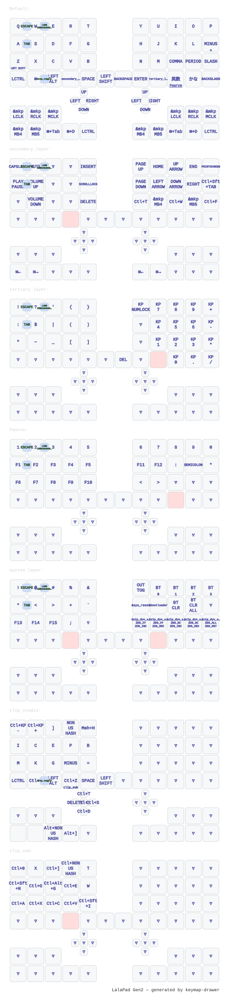
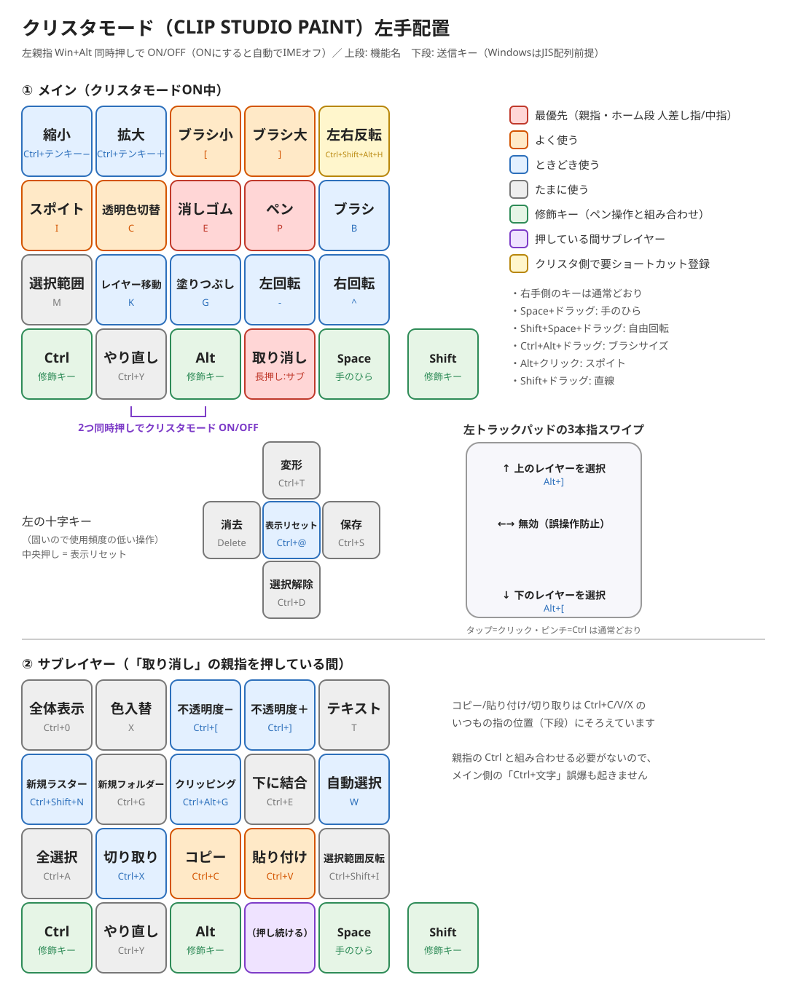

# zmk-config-LalaPadGen2

自分用 LalaPad Gen2 ZMK キーマップ設定

## キーマップ



> `config/lalapadgen2.keymap` を変更すると GitHub Actions が自動で画像を更新します。

## レイヤー構成（vi操作・Excel・ブラウジング向け最適化）

サーバ保守（TeraTerm + vi/シェル）とExcel、ブラウジングを1台のLalaPad Gen2だけで快適にこなせるよう、以下の観点でレイヤーを再設計しています。

- vi操作で記号を直感的に入力したい
- F4/F5などのファンクションキーが押しにくい
- 右手だけで数字入力したい
- カーソル移動（矢印キー）をもっと手軽に使いたい（左右にある十字型4方向スイッチが固く常用しづらい）
- ブラウジングをこのキーボードだけで完結させたい

レイヤー設計にあたっては、有名なミニマル分割キーボードレイアウトである [Miryoku](https://github.com/manna-harbour/miryoku) の考え方を参考にしています。Miryokuでは基本的に「レイヤーを起動する親指と、実際にキーを打つ手を逆にする」設計（例: 右親指でレイヤーを起動し、左手で数字を打つ）を採用しており、これは「レイヤーを保持している手を休ませつつ、もう一方の手だけで入力する」ためのものです。ただし今回は「テンキーを右手だけで完結させたい」という要件があったため、テンキーに関してはあえてMiryoku流とは逆に「レイヤーを起動する親指と入力する手を同じ（右手）にする」構成にしています。

### Secondary Layer（左手親指 `mo 1` 保持）: ファンクションキー & カーソル移動 & ブラウジング

- 左手: `F1`〜`F12`（1段目 F1-F5 / 2段目 F6-F10 / 3段目 F11-F12 + `Ctrl+Z`(元に戻す)・`Ctrl+Y`(やり直し)・`Ctrl+S`(保存)）。`F13`〜`F15`は使用頻度が低いため、従来通り両手同時押しのSystem Layerに残しています
  - これまで両手同時押し（System Layer）でしか出せなかった `F4` / `F5` を、左親指を押すだけの1段構えで出せます
  - `F4` はExcelの絶対参照切り替えにもそのまま使えます
- 右手: viの `hjkl` そのままのセマンティクスでカーソル移動 ＋ ブラウジング操作（Miryokuと同じ「起動する親指と反対の手」構成）
  - ホームポジション `H J K L` = `←` `↓` `↑` `→`（十字キーに頼らず、指を動かさずに移動できます）
  - 周辺: `Page Up` / `Home` / `Page Down` / `End`
  - ブラウジング操作: `Ctrl+T`（新規タブ）/ `Ctrl+W`（タブを閉じる）/ `Ctrl+Tab`・`Ctrl+Shift+Tab`（タブ切り替え）/ `Ctrl+F`（ページ内検索）/ マウスボタン4・5（戻る・進む）
  - 戻る/進む・タブ管理・検索・スクロールといったブラウジングの主要操作をこのレイヤーだけで完結できます

### Tertiary Layer（右手親指 `mo 2` 保持）: vi記号 & テンキー

- 左手: vi・シェル操作での実際の使用頻度をもとに記号を再配置（起動する親指と反対の手＝Miryokuと同じ構成）
  - `^` `?` `'` `{` `}` / `:` `$` `|` `(` `)` / `"` `~` `_` `[` `]`
  - **括弧ファミリー**: 右2列に `{ }`（1段目）/ `( )`（2段目）/ `[ ]`（3段目）を揃えて配置。「括弧は右2列、種類は段で選ぶ、開きは左・閉じは右」という一貫した法則にしています
  - ホームロウ（`:` `$` `|`）に最頻出の記号を集約: `:` はvi のコマンドモード（`:wq` `:%s/.../.../g`）、`$` はvi の行末移動とシェル変数展開の両方で高頻度、`|` はシェルのパイプ
  - `"` を追加しました。vi のレジスタ指定（`"ayy` `"+y` `"_d` など）で頻出するため、旧配置の `;` を置き換える形で確保しています
  - `?`（vi の逆検索）も1段目に引き上げ、旧`;`の代わりに1手で押せる位置にしました
  - `~`（シェルのホームディレクトリ）・`_`（スネークケースの変数名・ファイル名）もそのまま1手で押せる位置に残しています
- 右手: テンキー配列（`7 8 9 +` / `4 5 6 -` / `1 2 3 *` / `0 . ÷`）
  - **あえてMiryoku流とは逆に、レイヤーを起動する右親指と同じ右手に配置**しています。右親指で `mo 2` を保持しながら、そのまま右手の指だけでテンキーを打てるため、左手を一切使わずに数字入力が完結します

### System Layer（両手親指同時押し `mo 1` + `mo 2`）: 拡張記号 & システム設定

- 左手: Tertiary Layerほど連打しない記号を拡張として配置: `!` `@` `#` `%` `&` / `*` `<` `>` `+` `` ` `` / `F13` `F14` `F15` `;`
  - `=` は Default Layer の右手小指キー（タップで `-`・ホールドで `=`）と重複するため、こちらの表からは外しています
- 右手: Bluetooth選択・リセット・トラックパッド感度調整など（変更なし）

### クリスタ（CLIP STUDIO PAINT）用 左手デバイス機能

右手でペン（ペンタブ／液タブ）を持ったまま、左手だけでクリスタを操作するための「クリスタモード」です。

#### クリスタモード（左親指 `Win`+`Alt` 同時押しでON/OFF）



普段の入力ではまず同時に押さない左親指の `Win` と `Alt` を同時に押すと、左手全体がクリスタ専用キーになる「クリスタモード」に切り替わります（もう一度押すと元に戻ります）。右手側のキーはそのまま使えます。

切り替えと同時に **IMEオフ（`INT5`＝無変換）** も送信します。クリスタは日本語入力がオンだとツール切替などの1文字ショートカット（`P` `E` `B` `I` `[` `]` など）が反応しない仕様のため（[公式サポートの回答](https://www.clip-studio.com/clip_site/support/help/detail/svc/8/tid/26527)）、ONにした時点で必ず半角英数入力にしています。クリスタモード中にIMEをオンにした場合は、右手の `INT5` キーでオフに戻してください。

メイン（①）と、取り消しの親指を押している間だけ出るサブレイヤー（②）の2段構成です。左の十字キーと左トラックパッドの3本指スワイプにも機能を割り当てています。

```
① メイン
 縮小      拡大      ブラシ小   ブラシ大    全体表示
 スポイト  透明色    消しゴム   ペン        ブラシ
 選択範囲  色入替    レイヤー移動 塗りつぶし 左右反転※
 Ctrl  やり直し  Alt  取り消し/長押しで②  Space  Shift   ← 親指

② サブ（「取り消し」の親指を押している間）
 100%表示     自由変形     不透明度−   不透明度＋  テキスト
 新規ラスター 新規フォルダー クリッピング 下に結合    自動選択
 全選択       切り取り     コピー      貼り付け    選択範囲反転
```

よく使う操作ほど押しやすい位置に置いています（使用頻度は一般的なイラスト制作を想定した見積もりです）。

| 押しやすさ | 位置 | 割り当て |
|---|---|---|
| 最優先 | 親指（`Space` の隣、元 `mo 1`） | 取り消し `Ctrl+Z`（長押しでサブレイヤー） |
| 最優先 | ホーム段 人差し指／中指（`F` `D`） | ペン `P`／消しゴム `E` |
| 高 | ホーム段 薬指／小指（`S` `A`） | 透明色切替 `C`（ペンのまま消す）／スポイト `I` |
| 高 | 上段 中指／人差し指（`E` `R`） | ブラシサイズ 小 `[`／大 `]`（左が小・右が大） |
| 中 | ホーム段 人差し指内側（`G`） | ブラシ `B` |
| 中 | 上段 小指／薬指（`Q` `W`） | 縮小／拡大 |
| 中 | 下段 人差し指（`V`）・中指（`C`） | 塗りつぶし `G`／レイヤー移動 `K` |
| 中 | 左トラックパッドの3本指スワイプ | 左右=キャンバス回転 `-`／`^`、上下=選択レイヤーを上／下へ `Alt+]`／`Alt+[` |
| 低 | 残りの位置 | 全体表示・選択範囲 `M`・色入替 `X`・左右反転・やり直し |
| 低 | 左の十字キー（固い） | 上=変形 `Ctrl+T`、下=選択解除 `Ctrl+D`、左=消去 `Delete`、右=保存 `Ctrl+S`、中央押し=表示リセット `Ctrl+@` |

- **サブレイヤー（②）**: 取り消しの親指は、タップすると取り消し、押し続けるとサブレイヤーになります。親指を押したまますぐ次のキーを押してもサブ側として扱うよう `balanced` の判定にしています
  - 取り消しは指を離した時点で送られます。連打はそのまま使えます。押しっぱなしで連続取り消しをしたい場合は、一度タップしてから200ms以内にもう一度押して押し続けてください（quick-tap）
  - コピー／切り取り／貼り付けは、普段の `Ctrl+C`／`X`／`V` と同じ下段の指の位置にそろえています
  - 不透明度 `Ctrl+[`／`Ctrl+]` は、メインのブラシサイズ `[`／`]` の真下ではなく同じ上段の同じ位置です（ブラシサイズ＝メイン、不透明度＝サブ）
- **トラックパッドの3本指スワイプ**: TourBoxでダイヤルやスクロールに割り当てられることが多い「キャンバス回転」「レイヤーの上下移動」を、左トラックパッドの3本指スワイプに割り当てました。ドライバ（[zmk-driver-iqs9151](https://github.com/ShiniNet/zmk-driver-iqs9151)）の仕様上、スワイプは3本指のみで、1回のスワイプにつき1回だけ送られます（指を離すまで再送なし）。1本指はカーソル移動、2本指はスクロールのままです。タップ（クリック）とピンチ（`Ctrl`）は通常どおりです。通常時のスワイプ下（`Win+D`＝デスクトップ表示）がクリスタ作業中に誤爆しない効果もあります
- **ダブルタップを使わなかった理由**: ダブルタップ判定は1回目の入力を待たせる（取り消しの連打などが遅れる）ため、使用頻度の低い操作をまとめる手段としては、押している間だけのサブレイヤーを選びました
- 親指の `Ctrl`・`Alt`・`Space`・`Shift` は残しているので、`Space`+ドラッグ（手のひら）、`Shift+Space`+ドラッグ（自由回転）、`Ctrl+Alt`+ドラッグ（ブラシサイズ）、`Alt`+クリック（スポイト）、`Shift`+ドラッグ（直線）といった、ペンと組み合わせる操作がそのまま使えます
- ※左右反転（`Ctrl+Shift+Alt+H`）はクリスタに初期ショートカットがないため、クリスタの「ファイル」→「ショートカットキー設定」→「メインメニュー」→「表示」→「回転・反転」→「左右反転」で、このキーを押して登録してください（登録するまでは押しても何も起きません）
- 既存の同時押し `Q`+`W`(Esc)・`A`+`S`(Tab)・`W`+`E`(半角/全角) は、ツールの連続押しで誤爆しないようクリスタモード中だけ無効にしています（通常時はこれまでどおり）
- 注意: メイン（①）で親指の `Ctrl` を押しながら左手のキーを押すと「`Ctrl`＋そのキーに割り当てた文字」が送られます（例: `Ctrl`+ペンの位置 → `Ctrl+P` = 印刷）。コピーなどの `Ctrl` 系はサブレイヤー（②）を使ってください
- モード切り替え時は、RGB LEDのレイヤー変更表示（`CONFIG_RGBLED_WIDGET_SHOW_LAYER_CHANGE=y`）で状態を確認できます

#### 割り当ての根拠（左手デバイスの設定例との比較）

TourBox利用者が公開しているクリスタ用設定（[somejiro-lab](https://somejiro-lab.info/tourbox-shortcut/)・[kyotokeynote](https://kyotokeynote.com/blog/tourbox-clipstudio-preset/)・[comfortable-life](https://comfortable-life.jp/2022/04/tourbox_elite_setting/)・[runningdog](https://runningdog.mond.jp/blog/2024/06/23/tourbox-2/) の4例）と、CLIP STUDIO TABMATEの初期設定（取り消し／やり直し・回転・ブラシサイズ・ズーム。[PC Watch](https://pc.watch.impress.co.jp/docs/column/yajiuma-mini-review/1400045.html)）を比較し、どこに何を置くかを決めました。

| 採用例 | 機能 | 置き場所 |
|---|---|---|
| 4例すべて | 取り消し／やり直し・ブラシサイズ・ペン・消しゴム・選択範囲・左右反転・キャンバス回転・表示（回転・反転）リセット・ズーム | メイン／スワイプ／十字中央 |
| 3例 | 手のひら・保存・変形・スポイト・レイヤー移動・塗りつぶし・ブラシ・コピー／貼り付け／切り取り・レイヤーの上下移動・サブツール切替 | メイン／十字／サブ／スワイプ |
| 2例 | 選択解除・自動選択・色入替・全体表示・消去・新規フォルダー・テキスト | メイン／十字／サブ |
| 1例 | 透明色切替・100%表示・新規ラスター・下に結合・クリッピング・不透明度 | メイン（透明色のみ）／サブ |

- 「透明色切替」は採用例は少ないものの、ペンを持ち替えずに消しゴム代わりに使えるため、メインのホーム段に残しています
- 「サブツール切替」はクリスタに初期ショートカットがないため入れていません（使う場合はクリスタ側で登録してサブレイヤーの空きに追加してください）
- 「表示リセット（`Ctrl+@`、公式名 Reset display）」はクリスタの初期ショートカットです。TourBoxの例の「回転・反転リセット」に近い機能として採用しましたが、左右反転まで戻るかは実機で確認してください
- ズームは4例中2例が専用割り当て、残り2例はマウスホイール経由です

#### クリスタ側の前提と確認が必要な点

- 割り当ては左右反転を除きクリスタの初期ショートカット（Windows）に合わせています。メイン・十字キー・スワイプ・サブレイヤーで使っている `Ctrl`／`Alt` 系と回転 `-`／`^` は[公式ユーザーガイドのメニューショートカット一覧（英語）](https://help.clip-studio.com/en-us/manual_en/780_shortcuts/Menu_Shortcuts.htm)で確認済みです
- ツールの1文字ショートカット（`P` `E` `B` `I` `G` `M` `K`）は[公式のツールショートカット一覧](https://help.clip-studio.com/en-us/manual_en/780_shortcuts/Tool_Shortcuts.htm)、`X` `C` `[` `]` は[公式のオプションショートカット一覧](https://help.clip-studio.com/en-us/manual_en/780_shortcuts/Optional_Shortcuts.htm)で初期値であることを確認済みです
- ブラシサイズの `[` / `]` は「ブラシサイズパレットのひとつ小さい／大きいプリセットを選ぶ」動作です。Windowsのハードウェアキーボードレイアウトが **JIS配列** の環境に合わせ、JISの `[` キー位置（`RIGHT_BRACKET`）と `]` キー位置（`NON_US_HASH`）を送っています。US配列のキーコード（`LEFT_BRACKET`/`RIGHT_BRACKET`）のままだと、JIS環境では `@` / `[` として届き、ブラシ小は無反応・ブラシ大は逆に小さくなっていました。WindowsをUS配列に切り替えた場合は `&kp LEFT_BRACKET` / `&kp RIGHT_BRACKET` に戻してください
- それでも反応しないキーがある場合は、IMEがオフになっているか（タスクバーが `A` か）、クリスタの「ショートカットキー設定」でそのキーが別の機能に変更されていないかを確認してください
- 記号を含むキー（`[` `]` `@` `^`）はJIS配列の位置で送っています: `[`=`RIGHT_BRACKET`、`]`=`NON_US_HASH`、`@`=`LEFT_BRACKET`、`^`=`EQUAL`
- ズームは、キーボード配列（US/JIS）の影響を受けないようにテンキーの `+` / `-` を使っています

### 十字型4方向スイッチ（Default Layerの矢印キー）について

物理的な十字キーは固く、頻繁なカーソル移動には不向きなため、上記Secondary Layerの `HJKL` 配置をカーソル移動の基本手段として推奨します。十字キー自体は互換性のためDefault Layerに矢印キーとして残していますので、必要に応じて併用できます。

## 日本語入力 ⇔ 英語入力の切り替え（Windows / Microsoft IME）

Default レイヤー最下段、右手側に次の2キーを割り当てています。

```dts
&kp INT4   /* 元「変換」位置 : IMEオン（かな入力） */
&kp INT5   /* 元「無変換」位置 : IMEオフ（英数入力） */
```

- タスクバー表示が `A`（IMEオフ・半角英数字直接入力）の状態で `INT4` 位置を押す → `あ`（IMEオン・ローマ字でひらがな入力）
- タスクバー表示が `あ`（IMEオン）の状態で `INT5` 位置を押す → `A`（IMEオフ）

`Win + Space` は言語／IME自体の切り替えであり、今回のキーとは別物です。今回のキーは「Microsoft IMEを選択した状態のまま」日本語入力のオン・オフだけを切り替えます。

### 経緯：`LA(GRAVE)` は実機で反応しなかった

Microsoft公式ヘルプでは、英語(101/102)キーボード配列でMicrosoft IMEを使う場合、`Alt + `` ` ```（`&kp LA(GRAVE)`）が日本語入力オン・オフの切り替えとして案内されており、最初はこちらを採用していました。しかし実機検証の結果、`LA(GRAVE)` はIME切り替えに反応せず、一方で `INT5`（無変換位置、英数キー）はIMEオフとして機能することが確認できました。この結果を踏まえ、`INT4`/`INT5`（変換・無変換）のペアに戻しています。

- ZMK公式のWindows互換表では `INT4`/`INT5` は非対応キーとして扱われていますが、Microsoft IME側の設定（後述）を行うことで、このリポジトリの実機では安定して動作することを確認済みです
- `LA(GRAVE)` は環境によっては動作する可能性があるため、下記「JIS配列を使う場合」のセクションと合わせて代替設定として残しています

### 採用しなかった／見送ったキーと理由

- `LANG1` / `LANG2` : Windows上でIMEオン・オフとして動作する保証がない（`LANG1`=かな、`LANG2`=英数という挙動は主にmacOSの日本語入力の話であり、Windowsでの動作は保証されない）
- `LANG5`（半角/全角） : ZMK公式のWindows互換表で非対応。過去に本リポジトリでも試したが実機で無反応だった
- `LA(GRAVE)` : Microsoft公式ヘルプではWindows標準の切り替え方法として案内されているが、本リポジトリの実機検証では無反応だった（環境依存の可能性がある）
- `F6`〜`F10` : これらはIMEオン・オフではなく、変換候補の確定前文字列に対する変換操作（ひらがな/全角カナ/半角カナ/全角英数/半角英数）。Secondaryレイヤーにこれまで通り残しています

## Windows側で必要な設定

1. Windowsの設定から「時刻と言語」→「言語と地域」で「日本語」を言語として追加する
2. 日本語の入力方式（IME）として **Microsoft IME** を使用可能にする（追加時のデフォルトでも可）
3. LaLaPad公式ガイドの推奨に従う場合、そのキーボードのハードウェアキーボードレイアウトを **英語キーボード(101/102キー)** に設定する（「言語と地域」→「日本語」→「言語のオプション」→「キーボード」→「ハードウェア キーボード レイアウト」）
4. タスクバー右下の入力インジケーターでMicrosoft IMEを選択する
5. Microsoft IMEの設定を開き、「全般」→「キーとタッチのカスタマイズ」で、変換キーの動作を「IME−オン」、無変換キーの動作を「IME−オフ」に割り当てる（既に割り当て済みの場合は不要）
6. メモ帳などを開き、`INT4`/`INT5` を割り当てたキーを押して、タスクバー表示が `A` ⇔ `あ` で切り替わることを確認する

### 代替手段：PowerToys Keyboard Manager

Windowsのバージョンやビルドによっては、上記5の「キーとタッチのカスタマイズ」に無変換／変換キーの割り当て項目が見当たらない場合があります。その場合は [Microsoft PowerToys](https://learn.microsoft.com/ja-jp/windows/powertoys/) の **Keyboard Manager** で代わりにリマップできます。

1. PowerToysをインストールし、「Keyboard Manager」を有効にする
2. 「キーの再マップ」で以下を追加する
   - 無変換キー → `IME On`（システムショートカット）
   - 変換キー → `IME Off`（システムショートカット）
3. メモ帳などで動作を再確認する

この方式でも、ZMK側は `&kp INT4` / `&kp INT5` をそのまま送信するだけで、IMEオン・オフの最終的な切り替えはWindows側（Microsoft IME設定またはPowerToys）に任せる構成になります。

## JIS配列キーボード（Realforceなど）を併用する場合の注意

WindowsのハードウェアキーボードレイアウトはOS全体の設定であり、USB接続した複数のキーボードごとに完全に分離できない場合があります。そのため、JIS配列のキーボード（例: Realforce）とLaLaPad Gen2を同じPCで使い分ける場合は次の点に注意してください。

- Windowsの物理キーボード配列設定は、接続している複数のキーボード間で共有されることがある
- WindowsをUS(101/102)配列にすると、JIS配列のRealforceなど別キーボードの記号入力が刻印とずれる可能性がある
- 逆にWindowsをJIS配列にした場合、`Alt + `` ` ```（`LA(GRAVE)`）ではなく、`` ` `` 単体（`GRAVE`）が半角/全角キー相当としてIME切り替えに認識される場合がある

本リポジトリのデフォルト実装は `INT4`/`INT5`（変換・無変換）です。環境によって `LA(GRAVE)` や `GRAVE` 単体の方が動作する場合もあるため、`config/lalapadgen2.keymap` のDefaultレイヤーで該当キーを次のように変更して試すこともできます。

```dts
# デフォルト（変換・無変換、要Microsoft IME側のキー割り当て設定）
&kp INT4
&kp INT5

# US配列 + Alt+Grave を試す場合
&kp LA(GRAVE)

# JIS配列 + Grave単体を試す場合
&kp GRAVE
```

## 実機での確認手順

1. ビルドした右手側用のUF2ファイル（`lalapadgen2_right`）をLaLaPad Gen2の右側に書き込む
2. Windowsで入力方式をMicrosoft IMEに切り替える
3. メモ帳を開く
4. IME表示が `A` の状態で `INT4` 位置のキーを押す
5. 表示が `あ` になることを確認する
6. `aiueo` と入力して「あいうえお」に変換候補が出ることを確認する
7. `INT5` 位置のキーを押す
8. 表示が `A` になることを確認する
9. `aiueo` と入力して半角英字の `aiueo` がそのまま入力されることを確認する
10. F6〜F10（Secondaryレイヤー）、レイヤー切り替え、Space、Enter、Backspaceなど他のキーに影響がないことを確認する
